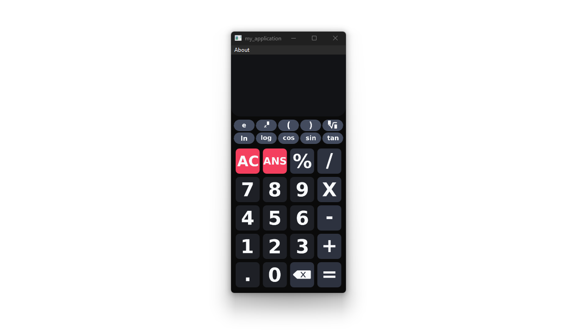
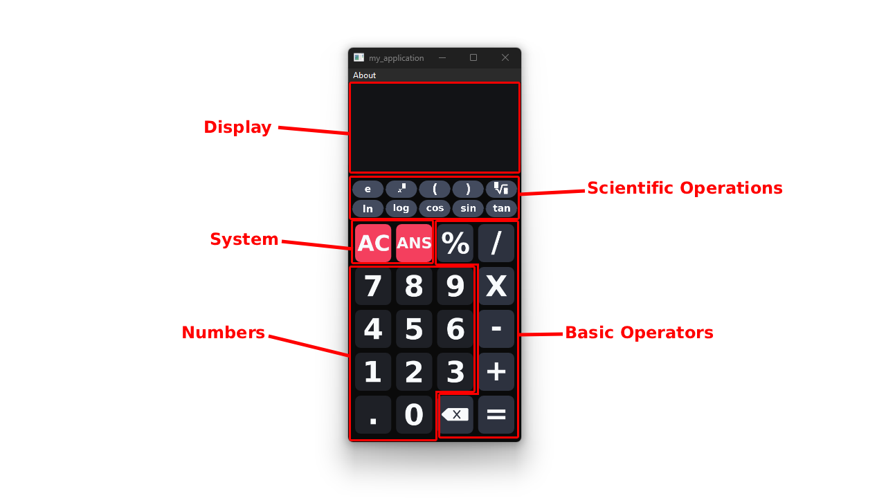

# calc
simple project making a scientific calculator while adhering to basic ui/ux design principles
# UI design

#### UI explained

# keybinds
|Keybind|description|note|
|-------|-----------|----| 
|Digit0|press buton 0||
|Digit1|press buton 1||
|Digit2|press buton 2||
|Digit3|press buton 3||
|Digit4|press buton 4||
|Digit5|press buton 5||
|Digit6|press buton 6||
|Digit7|press buton 7||
|Digit8|press buton 8||
|Digit9|press buton 9||
|Plus|press buton +||
|HyphenMinus|press buton -||
|Asterisk|press buton x||
|Slash|press buton /||
|Period|press buton .||
|Percent|press buton %||
|OpenParen|press buton \(||
|CloseParen|press buton )||
|E|press buton e||
|^|press buton ^||
|Enter|press buton =||
|Backspace|deletes last number before cursor||
|Shift + Backspace|press buton AC| clears screen|
|RightArrow|moves cursor right||
|LeftArrow|moves cursor left||
